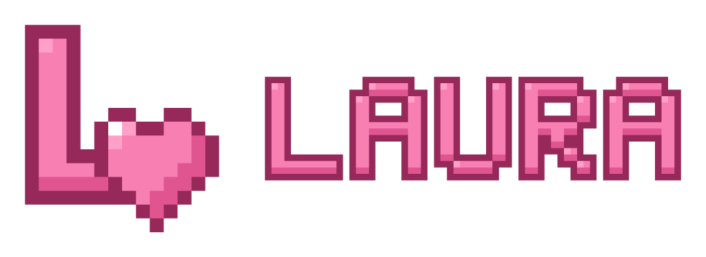

<div align="center">



# My Girlfriend Laura brand kit

[English](#english) | [Français](#français)

</div>

---

## English

An L that ends in a heart: Laura, and what she gives back.

### Files

- `logo/svg/`: every lockup (`icon`, `wordmark`, `horizontal`, `stacked`, `horizontal-tagline`, `stacked-tagline`) in every colorway (`color`, `reverse`, `mono-dark`, `mono-light`). Text is outlined, no font needed.
- `logo/png/`: the same at 512, 1024 and 2048 px on the long side, transparent.
- `logo/print/`: PDF and EPS for print.
- `icons/`: `favicon.ico`, `favicon.svg`, favicons 16 to 64 px, `apple-touch-icon.png`, PWA icons 192 and 512, a maskable icon and `site.webmanifest`, `avatar-512.png` for profiles.
- `banners/`: social and repository banners, PNG and JPG; their layered PhotoCraft sources are in `banners/source/`.
- `minecraft/`: `logo.png` for `logoFile` in `neoforge.mods.toml` / `mods.toml`, `icon-128.png` for `icon` in `fabric.mod.json`, `project-avatar-400.png` for CurseForge and Modrinth. Set `logoBlur=false` next to `logoFile` so pixel art stays sharp.
- `brand-sheet.png` / `brand-sheet.pdf`: the whole identity on one page.
- `brand-presentation.png` / `brand-presentation.pdf`: why the logo looks like this, its construction, where the colors come from, the type, and the logo in context (browser, GitHub, Discord, project page, phone, Minecraft mod list).
- `source/`: the editable masters (`master.vectorcraft`, `.ai`, `.pdf`), the drawn pieces and `brand.json`, which rebuilds everything.

### Colors

| Name | Hex |
|---|---|
| primary | `#F77FB2` |
| secondary | `#96285A` |
| accent | `#FFA0C8` |
| ink | `#2A1520` |
| paper | `#FFF5F8` |

### Use

- Use `color` on light backgrounds, `reverse` on dark ones, `mono-dark` / `mono-light` when only one color is possible.
- Keep clear space of a quarter of the mark's height on every side. Smallest sizes: horizontal logo 120 px wide, icon 16 px.
- Do not stretch, rotate, recolor outside the palette, add effects, or rebuild the wordmark in another font.

### In a README

```html
<picture>
  <source media="(prefers-color-scheme: dark)" srcset="Branding/logo/png/laura-horizontal-reverse-1024.png">
  
</picture>
```

---

## Français

Un L qui se termine en cœur : Laura, et ce qu'elle rend.

### Fichiers

- `logo/svg/` : chaque composition (`icon`, `wordmark`, `horizontal`, `stacked`, `horizontal-tagline`, `stacked-tagline`) dans chaque version de couleur (`color`, `reverse`, `mono-dark`, `mono-light`). Le texte est vectorisé, aucune police n'est nécessaire.
- `logo/png/` : les mêmes en 512, 1024 et 2048 px sur le grand côté, fond transparent.
- `logo/print/` : PDF et EPS pour l'impression.
- `icons/` : `favicon.ico`, `favicon.svg`, favicons de 16 à 64 px, `apple-touch-icon.png`, icônes PWA 192 et 512, une icône maskable et `site.webmanifest`, `avatar-512.png` pour les profils.
- `banners/` : bannières pour les réseaux et le dépôt, en PNG et JPG ; leurs sources PhotoCraft en calques sont dans `banners/source/`.
- `minecraft/` : `logo.png` pour `logoFile` dans `neoforge.mods.toml` / `mods.toml`, `icon-128.png` pour `icon` dans `fabric.mod.json`, `project-avatar-400.png` pour CurseForge et Modrinth. Mettre `logoBlur=false` à côté de `logoFile` pour garder le pixel art net.
- `brand-sheet.png` / `brand-sheet.pdf` : toute l'identité sur une page.
- `brand-presentation.png` / `brand-presentation.pdf` : pourquoi ce logo, sa construction, l'origine des couleurs, la typographie, et le logo en situation (navigateur, GitHub, Discord, page de projet, téléphone, liste des mods de Minecraft).
- `source/` : les fichiers maîtres modifiables (`master.vectorcraft`, `.ai`, `.pdf`), les éléments dessinés et `brand.json`, qui régénère tout.

### Couleurs

| Nom | Hex |
|---|---|
| primary | `#F77FB2` |
| secondary | `#96285A` |
| accent | `#FFA0C8` |
| ink | `#2A1520` |
| paper | `#FFF5F8` |

### Utilisation

- `color` sur fond clair, `reverse` sur fond sombre, `mono-dark` / `mono-light` quand une seule couleur est possible.
- Laisser une marge d'un quart de la hauteur du symbole tout autour. Tailles minimales : logo horizontal 120 px de large, icône 16 px.
- Ne pas déformer, pivoter, recolorer hors palette, ajouter d'effets, ni recomposer le logotype dans une autre police.

### Dans un README

Le bloc `<picture>` de la section anglaise affiche la version `reverse` en mode sombre et `color` en mode clair.

---

<div align="center">Author: vyrriox</div>
